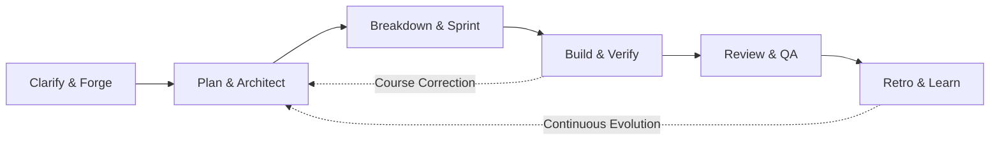
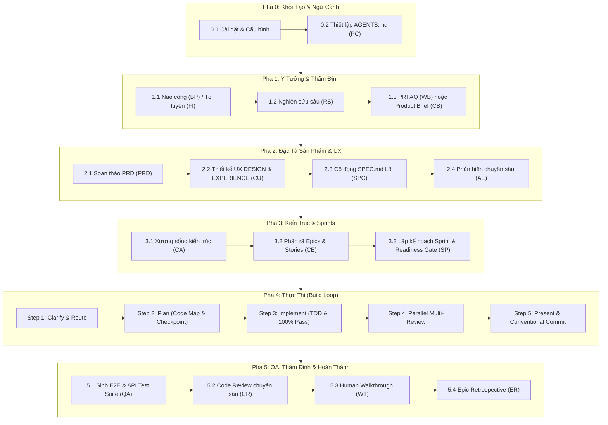
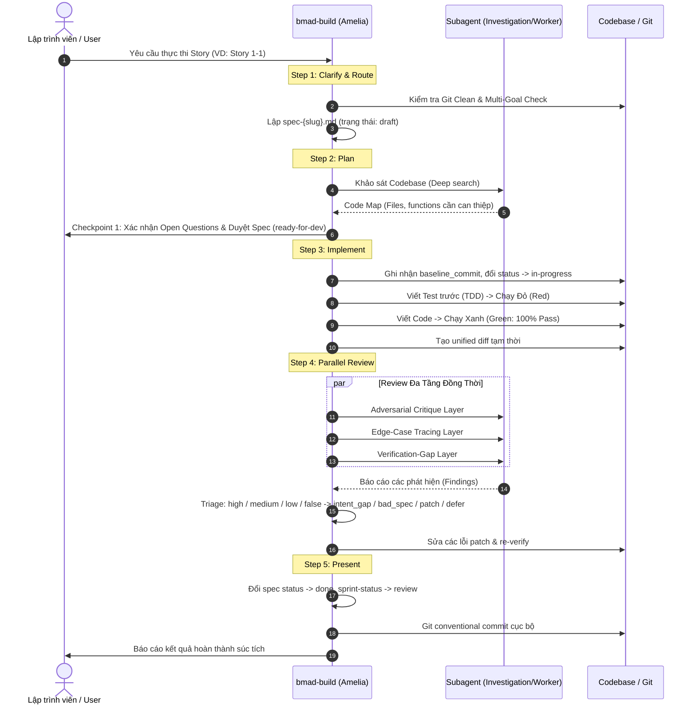
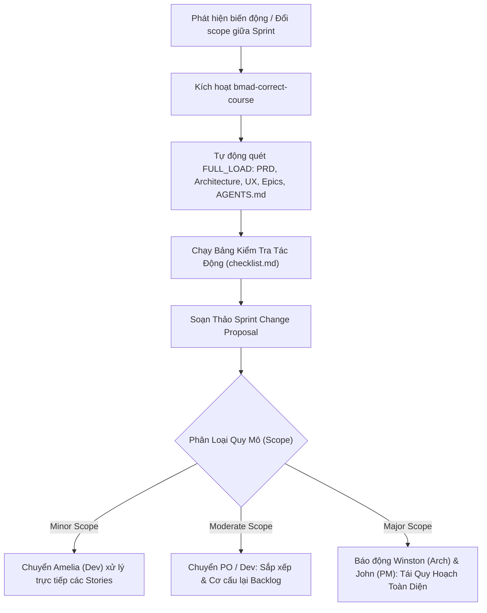

# CẨM NANG TOÀN DIỆN VỀ QUY TRÌNH PHÁT TRIỂN PHẦN MỀM VỚI BMAD METHOD (BMM)
> **Phiên bản tài liệu:** Chuẩn hóa theo kiến trúc BMAD Method (BMM Core & Tools)  
> **Mục tiêu:** Hướng dẫn step-by-step toàn diện quy trình phát triển phần mềm từ ý tưởng sơ khai đến khi hoàn thành, tích hợp các kịch bản xử lý biến động thực tế (thay đổi docs, thêm task, sửa lỗi, lệch sprint, phản biện chuyên sâu).

---

## MỤC LỤC
1. [Tổng Quan Về BMAD Method & Triết Lý Cốt Lõi](#1-tổng-quan-về-bmad-method--triết-lý-cốt-lõi)
2. [Hệ Thống Tác Tử AI Chuyên Biệt (Agent Personas)](#2-hệ-thống-tác-tử-ai-chuyên-biệt-agent-personas)
3. [Bảng Tra Cứu Nhanh Các Skill & Menu Codes](#3-bảng-tra-cứu-nhanh-các-skill--menu-codes)
4. [Cấu Trúc Thư Mục & Không Gian Lưu Trữ Chuẩn](#4-cấu-trúc-thư-mục--không-gian-lưu-trữ-chuẩn)
5. [Quy Trình Phát Triển Phần Mềm End-to-End (Step-by-Step)](#5-quy-trình-phát-triển-phần-mềm-end-to-end-step-by-step)
   - [Pha 0: Khởi Tạo Dự Án & Thiết Lập Ngữ Cảnh Repository](#pha-0-khởi-tạo-dự-án--thiết-lập-ngữ-cảnh-repository)
   - [Pha 1: Khám Phá, Nghiên Cứu & Tôi Luyện Ý Tưởng (Ideation & Recon)](#pha-1-khám-phá-nghiên-cứu--tôi-luyện-ý-tưởng-ideation--recon)
   - [Pha 2: Đặc Tả Sản Phẩm & Trải Nghiệm Người Dùng (PRD, UX & Spec)](#pha-2-đặc-tả-sản-phẩm--trải-nghiệm-người-dùng-prd-ux--spec)
   - [Pha 3: Thiết Kế Kiến Trúc & Phân Rã Công Việc (Architecture & Sprints)](#pha-3-thiết-kế-kiến-trúc--phân-rã-công-việc-architecture--sprints)
   - [Pha 4: Thực Thi Phát Triển Chuẩn Mực (Implementation / Build)](#pha-4-thực-thi-phát-triển-chuẩn-mực-implementation--build)
   - [Pha 5: Kiểm Thử Tự Động, Thẩm Định Mã Nguồn & Hồi Tưởng (Testing, Review & Retro)](#pha-5-kiểm-thử-tự-động-thẩm-định-mã-nguồn--hồi-tưởng-testing-review--retro)
6. [Sổ Tay Xử Lý Các Tình Huống Thực Tế Biến Động (Dynamic Scenarios)](#6-sổ-tay-xử-lý-các-tình-huống-thực-tế-biến-động-dynamic-scenarios)
   - [Tình huống 1: Bổ sung tài liệu / nghiên cứu mới trong quá trình làm](#tình-huống-1-bổ-sung-tài-liệu--nghiên-cứu-mới-trong-quá-trình-làm)
   - [Tình huống 2: Thay đổi tài liệu dự án trước khi lập Sprint (Planning Phase)](#tình-huống-2-thay-đổi-tài-liệu-dự-án-trước-khi-lập-sprint-planning-phase)
   - [Tình huống 3: Biến động lớn giữa Sprint (Mid-sprint Major Change) & Correct Course](#tình-huống-3-biến-động-lớn-giữa-sprint-mid-sprint-major-change--correct-course)
   - [Tình huống 4: Thêm task / story mới sau khi đã chốt Sprint](#tình-huống-4-thêm-task--story-mới-sau-khi-đã-chốt-sprint)
   - [Tình huống 5: Phát hiện xung đột kiến trúc / bế tắc kỹ thuật khi đang Code](#tình-huống-5-phát-hiện-xung-đột-kiến-trúc--bế-tắc-kỹ-thuật-khi-đang-code)
   - [Tình huống 6: Task quá lớn (>1600 tokens) hoặc chứa nhiều mục tiêu độc lập](#tình-huống-6-task-quá-lớn-1600-tokens-hoặc-chứa-nhiều-mục-tiêu-độc-lập)
   - [Tình huống 7: Cần đào sâu phản biện đa chiều hoặc phá vỡ bế tắc tư duy](#tình-huống-7-cần-đào-sâu-phản-biện-đa-chiều-hoặc-phá-vỡ-bế-tắc-tư-duy)
   - [Tình huống 8: Quản lý, kiểm tra định dạng và sửa chữa file Sprint Status](#tình-huống-8-quản-lý-kiểm-tra-định-dạng-và-sửa-chữa-file-sprint-status)
   - [Tình huống 9: Tác tử AI liên tục lặp lại một lỗi sai trong dự án](#tình-huống-9-tác-tử-ai-liên-tục-lặp-lại-một-lỗi-sai-trong-dự-án)
   - [Tình huống 10: Tùy biến prompt, luật và hành vi tác tử an toàn](#tình-huống-10-tùy-biến-prompt-luật-và-hành-vi-tác-tử-an-toàn)
7. [Các Nguyên Tắc Bất Di Bất Dịch (Golden Rules)](#7-các-nguyên-tắc-bất-di-bất-dịch-golden-rules)

---

## 1. TỔNG QUAN VỀ BMAD METHOD & TRIẾT LÝ CỐT LÕI

**BMad Method (Breakthrough Method for Agile AI-Driven Development - AiDD)** là phương pháp luận kỹ thuật phần mềm chuẩn mực được thiết kế chuyên biệt cho việc hợp tác giữa Con người và Trí tuệ Nhân tạo (Human-AI Pair Programming). 

Khác với các công cụ sinh mã tùy tiện (vibe-coding) dễ làm thoái hóa ngữ cảnh (context rot) và sinh mã rác, BMad thiết lập một quy trình kỷ luật nghiêm ngặt:



### Các nguyên tắc nền tảng:
1. **Kiến trúc tập tin phân bước (Step-File Micro-Architecture):** Mỗi kỹ năng (skill) được phân rã thành các file bước độc lập (`step-01`, `step-02`,...). Tác tử AI **chỉ nạp đúng 1 file bước tại một thời điểm** (Just-In-Time Loading), đọc hết toàn bộ file trước khi hành động, tuyệt đối không đoán trước các bước tương lai.
2. **Ký ức bất biến lũy tích (Append-Only Working Memory - `.memlog.md`):** Mọi quyết định thiết kế, ràng buộc, giả định và câu hỏi mở được ghi nối tiếp vào file `.memlog.md` thông qua script `memlog.py`. Tài liệu hoàn chỉnh (`SPEC.md`, `PRD.md`, `ARCHITECTURE-SPINE.md`) được **chưng cất (distill)** từ ký ức này, ngăn chặn tình trạng ghi đè làm mất dữ liệu lịch sử.
3. **Khai vấn thay vì làm hộ (Elicitation over Imposition):** Ở các pha lập kế hoạch (PRD, UX, Kiến trúc), tác tử AI đóng vai trò là một người cố vấn (Coach), đặt câu hỏi mở sâu sắc để người dùng đưa ra quyết định cốt lõi, không tự tiện áp đặt quyết định cá nhân trừ khi người dùng chọn chế độ làm nhanh (*Fast path*).
4. **Bằng chứng xác thực (Grounded Evidence, No Hallucinations):** Mọi phát hiện lỗi, đánh giá trong Code Review hay Retrospective đều phải đi kèm bằng chứng cụ thể (đường dẫn file, số dòng, hash commit, kết quả log kiểm thử). Những suy đoán vô căn cứ đều bị loại bỏ.
5. **Kỷ luật Test-First (TDD):** Kiểm thử phải được xác định rõ ràng qua ma trận Input/Output & Edge Cases trước khi viết mã. Tỷ lệ pass test phải là 100% trước khi bước vào khâu Review.
6. **Fresh Context Window:** Khuyến khích mở phiên hội thoại mới cho từng skill hoặc từng story lớn để đảm bảo cửa sổ ngữ cảnh luôn sạch sẽ, tránh hiện tượng suy giảm trí nhớ của LLM.

---

## 2. HỆ THỐNG TÁC TỬ AI CHUYÊN BIỆT (AGENT PERSONAS)

BMad định nghĩa 5 vai trò tác tử chủ chốt trong đội ngũ phát triển phần mềm, mỗi tác tử mang tư duy và phong cách giao tiếp đặc trưng:

| Biểu tượng | Tên Tác Tử | Vai Trò (Title) | Triết Lý & Phong Cách Làm Việc | Khi Nào Sử Dụng? |
| :---: | :---: | :---: | :--- | :--- |
| 📊 | **Mary** | Business Analyst | Vận dụng tư duy chiến lược của Michael Porter và nguyên lý kim tự tháp Minto. Mọi phát hiện đều gắn liền với bằng chứng xác thực, đại diện cho tiếng nói các bên liên quan. Giao tiếp sắc sảo, truy tìm nguyên nhân như một nhà điều tra. | Nghiên cứu thị trường, phân tích nghiệp vụ, đánh giá đối thủ cạnh tranh, phân tích dữ liệu domain. |
| 📋 | **John** | Product Manager | Tập trung vào *Jobs-to-be-Done (JTBD)*, giá trị người dùng là trên hết; tính khả thi kỹ thuật là ràng buộc chứ không phải động lực định hình sản phẩm. Giao tiếp như một điều tra viên: hỏi ngắn gọn, đào sâu dồn dập vào "Tại sao?". | Lập PRD, xác định phạm vi MVP, kiểm tra tính hợp lý của tính năng, bảo vệ giá trị cốt lõi sản phẩm. |
| 🎨 | **Sally** | UX Designer | Cân bằng sự thấu cảm người dùng với sự khắt khe về các trường hợp biên (edge cases). Khởi đầu đơn giản và hoàn thiện dần qua phản hồi. Giao tiếp như một đạo diễn mô tả phân cảnh trước khi bấm máy, tạo ra hành trình trải nghiệm sống động. | Thiết kế UI/UX, soạn thảo `DESIGN.md` (visual/tokens) và `EXPERIENCE.md` (flows, states, interactions). |
| 🏗️ | **Winston** | System Architect | Ưu tiên các công nghệ vững chắc, ổn định ("boring technology"); coi năng suất lập trình viên là thước đo kiến trúc; liên kết mọi quyết định với giá trị kinh doanh. Thảo luận như một kỹ sư kỳ cựu bên bảng trắng: điềm tĩnh, phân tích trade-off đa chiều. | Xây dựng kiến trúc hệ thống (`ARCHITECTURE-SPINE.md`), định hình cấu trúc module, thiết lập database contracts, API protocols. |
| 💻 | **Amelia** | Senior Software Engineer | Kỷ luật kiểm thử hàng đầu (Red - Green - Refactor), kiểm thử đạt 100% trước khi review, không nói suông. Giao tiếp chính xác, súc tích như lệnh terminal: dẫn chứng đường dẫn file, ID tiêu chí nghiệm thu (AC), commit hash rõ ràng. | Triển khai code các User Stories (`bmad-build`), fix bug, chạy test ma trận, thực hiện code review. |

---

## 3. BẢNG TRA CỨU NHANH CÁC SKILL & MENU CODES

Dưới đây là bảng tổng hợp danh mục toàn bộ các kỹ năng (Skills) của BMad:

| Menu Code | Tên Skill | Phân Nhóm (Phase) | Đầu Vào Chính (Inputs) | Đầu Ra Chính (Outputs) | Mục Đích Cốt Lõi |
| :---: | :--- | :---: | :--- | :--- | :--- |
| **`BH`** | `bmad-help` | Anytime | Trạng thái hiện tại | Hướng dẫn định vị & gợi ý bước tiếp | Định vị dự án đang ở pha nào, đề xuất bước tiếp theo phù hợp. |
| **`PC`** | `bmad-project-context` | Anytime | Repo root, conventions | `AGENTS.md` managed block | Thiết lập/đồng bộ quy chuẩn dự án, lệnh test, pitfalls cho AI. |
| **`BC`** | `bmad-customize` | Anytime | Cấu hình muốn đổi | File TOML override trong `_bmad/custom/` | Tùy biến prompt, hook, persistent facts mà không làm hỏng file gốc. |
| **`AE`** | `bmad-advanced-elicitation`| Checkpoint | Nội dung vừa tạo | Bản nâng cấp chất lượng cao | Phản biện đào sâu (Socratic, Pre-mortem, Red team, First principles). |
| **`PM`** | `bmad-party-mode` | Anytime | Chủ đề cần mổ xẻ | Biên bản thảo luận đa chiều | Thảo luận bàn tròn giữa nhiều chuyên gia AI (Mary, John, Winston,...). |
| **`BP`** | `bmad-brainstorming` | Plan / Ideation | Ý tưởng sơ khởi | Phiên não công, ý tưởng đột phá | Động não sinh ý tưởng thông qua các kỹ thuật sáng tạo. |
| **`FI`** | `bmad-forge-idea` | Plan / Ideation | Ý tưởng chưa rõ ràng | Refined Idea Brief | Thử áp lực ý tưởng sơ khai qua các persona đối kháng. |
| **`RS`** | `bmad-deep-recon` | Plan / Ideation | Chủ đề nghiên cứu | Báo cáo nghiên cứu có trích dẫn nguồn | Nghiên cứu kỹ thuật, thị trường, đối thủ, so sánh giải pháp. |
| **`WB`** | `bmad-prfaq` | Plan / Ideation | Ý tưởng sản phẩm | Tài liệu PRFAQ (Amazon Working Backwards)| Viết thông cáo báo chí và trả lời FAQ khách hàng khó tính. |
| **`CB`** | `bmad-product-brief` | Plan / Ideation | Khái niệm sản phẩm | Product Brief cô đọng | Tạo bản tóm tắt sản phẩm nhanh gọn khi đã định hình concept. |
| **`PRD`**| `bmad-prd` | Plan / 2-Planning | Brief, ý tưởng, research | `prd.md`, `.memlog.md`, `addendum.md` | Lập, sửa hoặc kiểm định tài liệu yêu cầu sản phẩm toàn diện. |
| **`CU`** | `bmad-ux` | Plan / 2-Planning | PRD, Brief | `DESIGN.md`, `EXPERIENCE.md` | Thiết kế giao diện (tokens/visual) và trải nghiệm (flows/states). |
| **`SPC`**| `bmad-spec` | Plan / Anytime | Bất kỳ tài liệu nào | Thư mục `specs/spec-{slug}/SPEC.md` | Cô đọng intent thành hợp đồng 5 trường lõi (Why, Cap, Constraint, Non-goals, Signal). |
| **`CA`** | `bmad-architecture` | Plan / Planning | PRD, UX, Spec | `ARCHITECTURE-SPINE.md`, `.memlog.md` | Thiết lập xương sống kiến trúc: Invariants, AD-n decisions, API/DB. |
| **`CE`** | `bmad-create-epics-and-stories`| Plan / Planning | PRD, Architecture | Danh sách Epics & User Stories có AC | Phân rã hệ thống thành Epics và Stories có Acceptance Criteria. |
| **`SP`** | `bmad-sprint-planning` | Plan / Planning | Epics, PRD, Arch | `sprint-status.yaml`, Readiness report | Thẩm định tính sẵn sàng thực thi (Readiness Gate) và lập kế hoạch Sprint. |
| **`SS`** | `bmad-sprint-planning:status`| Anytime | `sprint-status.yaml` | Báo cáo tiến độ, rủi ro, việc tiếp theo| Theo dõi tiến độ Sprint hiện tại trong nháy mắt. |
| **`BD`** | `bmad-build` | Ship / Dev | User Story / Task | Mã nguồn, tests, spec trạng thái done | Quy trình chuẩn 5 bước biến Story thành Code hoàn thiện. |
| **`CR`** | `bmad-code-review` | Ship / Review | Git diff, commit, files | Báo cáo đánh giá code đa tầng | Review code chuyên sâu độc lập với nhiều reviewer song song. |
| **`RV`** | `bmad-review` | Ship / Review | Diff, PR, docs | Danh sách phát hiện (findings JSON & md) | Thẩm định đối kháng qua các lăng kính (adversarial, edge cases,...). |
| **`WT`** | `bmad-walkthrough` | Ship / Human | Thay đổi mã nguồn | Hướng dẫn kiểm thử thủ công cho người dùng| Dẫn dắt người dùng kiểm tra thay đổi, điểm cần chú ý và cách test. |
| **`QA`** | `bmad-qa-generate-e2e-tests`| Ship / QA | Mã nguồn tính năng | Bộ test tự động (API / E2E tests) | Tự động sinh test suite tích hợp & E2E cho tính năng đã xong. |
| **`ER`** | `bmad-retrospective` | Ship / Retro | Epic hoàn thành, Git logs | Báo cáo Retrospective, quyết định nghiệm thu | Họp hồi tưởng sau khi hoàn tất Epic, đúc rút bài học quy trình. |
| **`CC`** | `bmad-correct-course` | Anytime | Sự cố, đổi scope | `sprint-change-proposal-{date}.md` | Xử lý biến động lớn giữa Sprint, phân tích tác động toàn diện. |

---

## 4. CẤU TRÚC THƯ MỤC & KHÔNG GIAN LƯU TRỮ CHUẨN

Một dự án sau khi tích hợp BMad sẽ tuân theo cấu trúc tổ chức không gian lưu trữ rõ ràng:

```text
my-project/
├── .agent/skills/                  # Chứa toàn bộ các thư mục skill của BMAD
│   ├── bmad-build/
│   ├── bmad-prd/
│   ├── bmad-architecture/
│   └── ...
├── _bmad/                          # Cấu hình lõi do BMAD quản lý
│   ├── config.toml                 # File cấu hình do installer tạo (READ-ONLY)
│   ├── custom/                     # Nơi ghi các tùy biến (Overrides) an toàn
│   │   ├── config.toml             # Tùy biến cấp độ Team (commit lên Git)
│   │   ├── config.user.toml        # Tùy biến cấp độ Cá nhân (được Gitignore)
│   │   └── <skill-name>.toml       # Override riêng cho từng skill
│   └── scripts/                    # Scripts tiện ích (memlog.py, resolve_config.py,...)
├── _bmad-output/                   # Nơi chứa toàn bộ sản phẩm tài liệu (Artifacts)
│   ├── planning-artifacts/         # Chứa tài liệu pha lập kế hoạch
│   │   ├── prd/ (hoặc prd.md)      # Tài liệu PRD hoàn chỉnh
│   │   ├── ux/                     # DESIGN.md và EXPERIENCE.md
│   │   ├── architecture/           # ARCHITECTURE-SPINE.md
│   │   └── epics/                  # Danh sách Epics và Stories
│   └── implementation-artifacts/   # Chứa tài liệu pha thực thi
│       ├── sprint-status.yaml      # File trạng thái sprint quản lý bằng script
│       ├── deferred-work.md        # Các task bị cắt giảm/tách nhánh lưu lại
│       ├── spec-*.md               # Các spec triển khai của từng story
│       └── sprint-change-proposal-*.md # Các đề xuất điều chỉnh sprint
├── docs/                           # Tài liệu nghiệp vụ & tri thức chung của dự án
├── AGENTS.md                       # Hướng dẫn quy chuẩn dành cho Tác tử AI (Managed block)
└── src/                            # Mã nguồn ứng dụng thực tế
```

---

## 5. QUY TRÌNH PHÁT TRIỂN PHẦN MỀM END-TO-END (STEP-BY-STEP)

Dưới đây là hành trình 6 giai đoạn phát triển phần mềm chuẩn mực từ ý tưởng đến thành phẩm:



---

### PHA 0: KHỞI TẠO DỰ ÁN & THIẾT LẬP NGỮ CẢNH REPOSITORY

Mục tiêu của pha này là chuẩn bị môi trường chuẩn mực để mọi tác tử AI hiểu rõ các ràng buộc, lệnh chạy và đặc thù của dự án.

#### Bước 0.1: Cài đặt và kích hoạt BMAD
- **Cách cài đặt**:
  * Bản ổn định (v6.12): Chạy lệnh `npx bmad-method install` tại thư mục gốc dự án.
  * Bản v7 Preview Alpha: Chạy `npx skills add bmad-code-org/BMAD-METHOD`.
- Kiểm tra cài đặt bằng cách gọi: `bmad-help` (`BH`).
- AI sẽ quét cấu hình và hiển thị trạng thái ban đầu của dự án.

#### Bước 0.2: Thiết lập `AGENTS.md` với `bmad-project-context` (`PC`)
- **Mục tiêu**: Xây dựng một khối quản trị bất biến trong file `AGENTS.md` (giữa các thẻ `bmad:context`), định nghĩa:
  1. Các lệnh build, lint, test đã được xác minh thực tế (verified commands).
  2. Các quy ước kiến trúc khác với mặc định.
  3. Các khu vực đóng băng không được tùy tiện sửa (frozen paths).
  4. Các cạm bẫy đã biết mà AI hay mắc phải (pitfalls).
- **Cách thực hiện**:
  * Nhập lệnh trong chat: `bmad-project-context`
  * Chọn chế độ: `setup` (dự án mới toanh) hoặc `adopt` (dự án đã có file hướng dẫn nhưng chưa quản lý theo chuẩn BMad).
  * AI sẽ quét `package.json`, `pyproject.toml`, CI configs,... và phỏng vấn bạn về các quy định riêng. Sau khi bạn duyệt, file `AGENTS.md` sẽ được tạo/cập nhật.

---

### PHA 1: KHÁM PHÁ, NGHIÊN CỨU & TÔI LUYỆN Ý TƯỞNG (IDEATION & RECON)

Pha này giúp biến một ý nghĩ mơ hồ thành một định hướng kinh doanh và sản phẩm vững chắc trước khi tốn nguồn lực lập trình.

#### Bước 1.1: Động não và Thử áp lực ý tưởng
- **Tình huống A (Ý tưởng quá mới hoặc chưa rõ ràng)**:
  * Gọi: `bmad-brainstorming` (`BP`).
  * AI sẽ dẫn dắt bạn qua các kỹ thuật như Crazy Eights, SCAMPER, Reverse Brainstorming để mở rộng góc nhìn.
- **Tình huống B (Đã có ý tưởng thô nhưng cần kiểm tra tính khả thi và điểm yếu)**:
  * Gọi: `bmad-forge-idea` (`FI`).
  * Các persona đối lập sẽ liên tục đặt các câu hỏi hóc búa (stress-test) vào các lỗ hổng giả định cho đến khi bạn đủ tự tin tiến hành hoặc quyết định hủy bỏ sớm để tránh lãng phí.

#### Bước 1.2: Nghiên cứu chuyên sâu với `bmad-deep-recon` (`RS`)
- **Mục tiêu**: Bổ sung dữ liệu thực tế thay vì suy đoán viển vông.
- Gọi: `bmad-deep-recon`
- Chọn loại hình nghiên cứu:
  * `market`: Dung lượng thị trường, xu hướng khách hàng.
  * `technical`: Thư viện, framework, giải pháp kỹ thuật khả thi.
  * `competitive`: Phân tích đối thủ cạnh tranh hiện hữu.
  * `candidate-comparison`: Đặt 2 hoặc nhiều công nghệ lên bàn cân so sánh (ví dụ: Postgres vs MongoDB).
- Kết quả lưu tại: `{planning_artifacts}/research/`.

#### Bước 1.3: Thẩm định giá trị cốt lõi
- **Lựa chọn 1 (Phương pháp Amazon Working Backwards)**: Gọi `bmad-prfaq` (`WB`). AI cùng bạn viết thông cáo báo chí (Press Release) ngày sản phẩm ra mắt trước, sau đó trả lời các câu hỏi FAQ gai góc nhất của khách hàng.
- **Lựa chọn 2 (Đã kiên định với giải pháp)**: Gọi `bmad-product-brief` (`CB`) để tóm tắt ngắn gọn mục tiêu, đối tượng người dùng và phạm vi trong file `product-brief.md`.

---

### PHA 2: ĐẶC TẢ SẢN PHẨM & TRẢI NGHIỆM NGƯỜI DÙNG (PRD, UX & SPEC)

Chuyển đổi ý tưởng đã được chứng minh thành các tài liệu đặc tả chuẩn xác, sẵn sàng cho khâu kỹ thuật.

#### Bước 2.1: Soạn thảo PRD chuẩn mực với `bmad-prd` (`PRD`)
- **Tác tử đảm trách**: **John** (Product Manager)
- Gọi lệnh: `bmad-prd` (hoặc nói "create PRD")
- **Quy trình tương tác**:
  1. *Brain Dump*: Bạn chia sẻ toàn bộ ghi chú, ý tưởng, tệp brief hoặc research có sẵn.
  2. *Chọn chế độ*:
     - **Coaching path** (Mặc định - Khuyên dùng): John đồng hành từng phần, đặt câu hỏi JTBD, xác định lo ngại (Concern scan), phân tích hành trình người dùng.
     - **Fast path**: John tổng hợp các khoảng trống thành 1-2 câu hỏi, tự suy luận và gắn cờ `[ASSUMPTION]` cho bạn duyệt nhanh.
  3. Mọi quyết định được lưu tự động vào `.memlog.md`. Các ý tưởng chi tiết về kỹ thuật được chuyển vào `addendum.md`.
  4. Xuất file: `{planning_artifacts}/prd.md`.

#### Bước 2.2: Thiết kế UX toàn diện với `bmad-ux` (`CU`)
- **Tác tử đảm trách**: **Sally** (UX Designer)
- Gọi lệnh: `bmad-ux` (hoặc nói "lets create UX design")
- **Sản phẩm tạo ra gồm 2 tài liệu sóng đôi**:
  1. **`DESIGN.md` (How it looks - Theo chuẩn Google Labs)**:
     - Định nghĩa Design Tokens dạng YAML frontmatter: màu sắc (`colors`), font chữ (`typography`), bo góc (`rounded`), khoảng cách (`spacing`), components.
     - Nội dung: Brand identity, elevation, quy tắc Do's and Don'ts.
  2. **`EXPERIENCE.md` (How it behaves - Trải nghiệm tương tác)**:
     - Kiến trúc thông tin (Information Architecture).
     - Microcopy, Voice and Tone.
     - Mẫu hành vi component, trạng thái (Loading, Empty, Error, Success).
     - Luồng hành trình người dùng trọng tâm (Key Flows có điểm cao trào - climax beat).

#### Bước 2.3: Đúc kết Hợp đồng Đặc tả Lõi với `bmad-spec` (`SPC`)
- Gọi lệnh: `bmad-spec`
- AI sẽ chắt lọc toàn bộ dữ liệu từ Brief, PRD, UX thành bản đặc tả cô đọng `SPEC.md` trong thư mục `specs/spec-{slug}/` chứa **5 trường hạt nhân (Five-Field Kernel)**:
  1. **Why**: Lý do tồn tại của tính năng/hệ thống.
  2. **Capabilities (`CAP-N`)**: Danh sách năng lực cụ thể có mã định danh ổn định.
  3. **Constraints**: Các ràng buộc kỹ thuật, pháp lý, hiệu năng.
  4. **Non-goals**: Những thứ dứt khoát KHÔNG làm trong đợt này.
  5. **Success signal**: Dấu hiệu đo lường sự thành công.

#### Bước 2.4: Phản biện chuyên sâu với `bmad-advanced-elicitation` (`AE`)
- Tại bước này, để tránh sót lỗi tư duy, gọi: `bmad-advanced-elicitation`
- Chọn phương pháp phản biện:
  * **Pre-mortem**: Giả định dự án thất bại sau 6 tháng ra mắt, tìm nguyên nhân gốc rễ.
  * **Red team**: Đóng vai tin tặc hoặc đối thủ để tìm lỗ hổng logic, bảo mật.
  * **First principles**: Bóc tách mọi giả định không cần thiết về nguyên lý cơ bản.
  * **Socratic**: Đặt câu hỏi truy vấn đến tận cùng lý do thiết kế.

---

### PHA 3: THIẾT KẾ KIẾN TRÚC & PHÂN RÃ CÔNG VIỆC (ARCHITECTURE & SPRINTS)

Xác định cách thức xây dựng hệ thống bền vững và phân chia công việc thành các đơn vị có thể bàn giao độc lập.

#### Bước 3.1: Xây dựng Xương Sống Kiến Trúc với `bmad-architecture` (`CA`)
- **Tác tử đảm trách**: **Winston** (System Architect)
- Gọi lệnh: `bmad-architecture` (hoặc nói "create technical architecture")
- **Nguyên lý Xương Sống (Architecture Spine)**:
  * **Invariants (Bất biến)**: Chỉ chốt những quyết định mang tính ràng buộc cốt lõi mà nếu hai lập trình viên làm độc lập có thể tạo ra xung đột không tương thích (Paradigm kiến trúc, boundary rules, state mutation rules, ai sở hữu shared data).
  * **Seed (Hạt giống)**: Stack công nghệ ban đầu, cấu trúc thư mục gợi ý (sau khi code hình thành thì code sẽ tự sở hữu cấu trúc này).
  * Mỗi quyết định kiến trúc được đánh mã `AD-n` kèm 3 thành phần: `Binds` (Ràng buộc cái gì), `Prevents` (Ngăn chặn sai lệch nào), `Rule` (Quy tắc bắt buộc).
- Đầu ra: `{planning_artifacts}/architecture/ARCHITECTURE-SPINE.md`.

#### Bước 3.2: Bẻ nhỏ thành Epics và Stories với `bmad-create-epics-and-stories` (`CE`)
- Gọi lệnh: `bmad-create-epics-and-stories`
- **Quy chuẩn của User Story trong BMad**:
  * Mỗi story mang lại giá trị độc lập cho người dùng.
  * Tiêu chí chấp nhận (**Acceptance Criteria - AC**) bắt buộc viết dưới định dạng **Given / When / Then**.
  * Định lượng phạm vi: Kích thước tối ưu của một story là **900 – 1600 tokens** để LLM xử lý chuẩn xác nhất mà không bị quá tải ngữ cảnh.
- Đầu ra: Danh sách Epics và Stories trong `{planning_artifacts}/epics/`.

#### Bước 3.3: Lập kế hoạch Sprint & Cổng Kiểm Định Thực Thi với `bmad-sprint-planning` (`SP`)
- Gọi lệnh: `bmad-sprint-planning`
- **Bước 1: Chạy cổng kiểm định sẵn sàng (Readiness Gate)**:
  * AI kiểm tra chéo: PRD đã đủ rõ? Architecture đã chốt? UX đã có? Các Stories có AC đầy đủ?
  * Đưa ra kết luận: **PASS**, **CONCERNS** (có thể làm nhưng lưu ý rủi ro), hoặc **FAIL** (bắt buộc bổ sung tài liệu trước khi code).
- **Bước 2: Tạo file theo dõi tiến độ Sprint (`sprint-status.yaml`)**:
  * Chạy kịch bản nội bộ để phân tích Epics và sinh file `{implementation_artifacts}/sprint-status.yaml`.
  * Quản lý trạng thái từng story: `backlog` -> `in-progress` -> `review` -> `done`.

---

### PHA 4: THỰC THI PHÁT TRIỂN CHUẨN MỰC (IMPLEMENTATION / BUILD)

Đây là trái tim của quá trình lập trình. Mỗi Story sẽ được thực thi qua kỹ năng `bmad-build` (`BD`) do **Amelia** dẫn dắt theo quy trình 5 bước nghiêm ngặt.



#### Chi tiết 5 bước của `bmad-build`:

1. **Step 1: Clarify & Route (`step-01-clarify-and-route.md`)**
   - Đọc intent từ yêu cầu của bạn.
   - Kiểm tra Git working tree: Phải sạch sẽ (clean), nhánh làm việc phải đúng ngữ cảnh.
   - **Scope Standard (Multi-goal Check)**: Kiểm tra xem công việc có bị ôm đồm nhiều mục tiêu độc lập không. Nếu có, tách phần thừa sang `{implementation_artifacts}/deferred-work.md`.
   - Tạo file spec cho công việc: `{implementation_artifacts}/spec-{slug}.md` (trạng thái `draft`).

2. **Step 2: Plan (`step-02-plan.md`)**
   - Đội điều tra (subagent) quét sâu codebase để vẽ **Code Map**: Đường dẫn file cụ thể, hàm cần gọi, cái gì tái sử dụng, cái gì tuyệt đối không sửa.
   - Nhận diện các yếu tố không thể đảo ngược (*irreversibles*: database migration, xóa dữ liệu).
   - Nếu có khoảng trống yêu cầu (*intent gaps*), liệt kê thành danh sách `## Open Questions`.
   - **CHECKPOINT 1 (Dừng chờ người dùng)**: Trình bày bản Spec. Bạn có thể yêu cầu sửa, phản biện thêm (`bmad-advanced-elicitation`) hoặc bấm **Approve**. Khi bạn duyệt, khối `<frozen-after-approval>` sẽ bị khóa vĩnh viễn (status: `ready-for-dev`).

3. **Step 3: Implement (`step-03-implement.md`)**
   - Ghi lại `baseline_commit` vào frontmatter để làm mốc đối chiếu diff sau này.
   - Chuyển trạng thái spec sang `in-progress` và cập nhật `sprint-status.yaml`.
   - Thực thi TDD: Viết test cho ma trận I/O và Edge Cases, viết code đáp ứng test, đảm bảo **100% test pass**.
   - Tạo file unified diff toàn bộ thay đổi so với `baseline_commit`.

4. **Step 4: Review (`step-04-review.md`)**
   - Đổi spec status sang `in-review`.
   - Khởi chạy đồng thời các tầng review độc lập bằng subagent:
     * *Adversarial Lens*: Tìm các điểm mã nguồn mong manh, dễ vỡ.
     * *Edge-Case Lens*: Đối chiếu trực tiếp với ma trận I/O xem có sót trường hợp biên nào không.
     * *Verification-Gap Lens*: Kiểm tra xem có test case nào bị viết "cho có" mà không thực sự assert đúng logic không.
   - **Triage (Phân loại phán quyết)**:
     * Mức độ: `high`, `medium`, `low`, `false`, `maybe-false`.
     * Hướng xử lý:
       - `patch`: Lỗi nhỏ do lần code này gây ra -> Sửa ngay lập tức và re-test.
       - `bad_spec`: Spec viết thiếu rõ ràng dẫn đến code sai -> Cần cập nhật lại spec.
       - `intent_gap`: Mục tiêu ban đầu của người dùng chưa rõ -> Hỏi người dùng.
       - `defer`: Lỗi tồn tại từ trước hoặc ngoài scope -> Ghi nhận lại, không sửa trong đợt này để tránh phình phạm vi.

5. **Step 5: Present (`step-05-present.md`)**
   - Đổi trạng thái spec sang `done`.
   - Cập nhật `sprint-status.yaml` sang `review`.
   - Tạo commit Git cục bộ với thông điệp chuẩn mực (Conventional Commit, ví dụ: `feat(auth): implement 2fa login`).
   - Báo cáo kết quả súc tích (1-2 câu) cho người dùng kèm commit hash. Tuyệt đối **không tự động `git push`** lên remote.

---

### PHA 5: KIỂM THỬ TỰ ĐỘNG, THẨM ĐỊNH MÃ NGUỒN & HỒI TƯỞNG (TESTING, REVIEW & RETRO)

Hoàn thiện, củng cố chất lượng và rút bài học cho toàn bộ hệ thống sau khi các stories trong Epic hoàn thành.

#### Bước 5.1: Sinh bộ test tích hợp & E2E với `bmad-qa-generate-e2e-tests` (`QA`)
- Sau khi code tính năng đã chạy, gọi: `bmad-qa-generate-e2e-tests`
- Tác tử QA sẽ đọc PRD, Architecture và mã nguồn vừa viết để sinh ra các kịch bản kiểm thử tự động End-to-End (Playwright/Cypress/Selenium) hoặc kiểm thử API (Postman/Pytest-requests), kiểm tra tính toàn vẹn của dữ liệu qua các tầng.

#### Bước 5.2: Code Review độc lập toàn diện với `bmad-code-review` (`CR`)
- Gọi: `bmad-code-review` (hoặc nói "run code review")
- Đây là đợt rà soát bổ sung độc lập trên toàn bộ branch hoặc pull request trước khi merge. Các reviewer AI chạy song song để bắt các lỗi về hiệu năng, rò rỉ bộ nhớ (memory leaks), bảo mật (OWASP) và sự tuân thủ quy ước dự án.

#### Bước 5.3: Hướng dẫn người dùng thẩm duyệt với `bmad-walkthrough` (`WT`)
- Gọi: `bmad-walkthrough` (hoặc "walk me through this change")
- AI sẽ đóng vai trò người dẫn tour kỹ thuật:
  1. Giải thích lý do và bối cảnh thay đổi.
  2. Chỉ ra những file trọng yếu cần bạn đọc kỹ.
  3. Hướng dẫn chi tiết các bước chạy thử trên máy của bạn (lệnh khởi động, tài khoản test, URL cần bấm, kết quả mong đợi).

#### Bước 5.4: Họp hồi tưởng Epic với `bmad-retrospective` (`ER`)
- Khi tất cả stories của một Epic đã đạt trạng thái `done`, gọi: `bmad-retrospective`
- **Nội dung đánh giá**:
  * Đối chiếu thành phẩm thực tế với mục tiêu ban đầu trong PRD và Architecture.
  * Phân tích các phát hiện trong diff và commit logs xem có phát sinh nợ kỹ thuật (technical debt) không.
  * Đánh giá quy trình: Có story nào bị tắc nghẽn? Có ước lượng nào bị sai lệch lớn?
  * Đưa ra **Quyết định nghiệm thu (Acceptance Verdict)**: Nghiệm thu (Accepted) hoặc Từ chối (Rejected - yêu cầu điều chỉnh).
  * Đầu ra: Báo cáo `{implementation_artifacts}/epic-<N>-retro-<date>.md`.

---

## 6. SỔ TAY XỬ LÝ CÁC TÌNH HUỐNG THỰC TẾ BIẾN ĐỘNG (DYNAMIC SCENARIOS)

Trong thực tế phát triển phần mềm, yêu cầu và bối cảnh liên tục biến động. Dưới đây là kim chỉ nam xử lý từng tình huống cụ thể bằng BMAD:

---

### TÌNH HUỐNG 1: BỔ SUNG TÀI LIỆU / NGHIÊN CỨU MỚI TRONG QUÁ TRÌNH LÀM
*Ví dụ: Khi đang làm, phát hiện cần tích hợp thêm cổng thanh toán ZaloPay chưa có trong spec ban đầu, hoặc khách hàng gửi thêm tài liệu API của bên thứ ba.*

- **Bước 1**: Đặt tài liệu mới vào thư mục `{project_knowledge}` (mặc định là `docs/` hoặc `docs/api/`).
- **Bước 2**: Nếu cần nghiên cứu đối chiếu kỹ thuật mới:
  * Chạy: `bmad-deep-recon technical`
  * AI sẽ tóm tắt tài liệu, kiểm tra các phiên bản tương thích và tạo báo cáo nghiên cứu có dẫn nguồn tại `{planning_artifacts}/research/`.
- **Bước 3**: Bổ sung quyết định vào bộ nhớ dự án:
  * Chạy script memlog:
    ```bash
    uv run _bmad/scripts/memlog.py append --workspace <doc_workspace> --type constraint --text "Tích hợp cổng ZaloPay v2 theo tài liệu docs/zalopay-api.pdf"
    ```
- **Bước 4**: Cập nhật lại `AGENTS.md` (nếu tài liệu mới bổ sung quy chuẩn/lệnh build mới):
  * Chạy: `bmad-project-context refresh`.

---

### TÌNH HUỐNG 2: THAY ĐỔI TÀI LIỆU DỰ ÁN TRƯỚC KHI LẬP SPRINT (PLANNING PHASE)
*Ví dụ: PRD đã viết xong nhưng muốn đổi luồng người dùng từ Email OTP sang Social Login; hoặc Kiến trúc muốn đổi từ REST sang gRPC.*

- **Quy tắc vàng**: **Tuyệt đối không sửa tay trực tiếp vào nội dung chắt lọc nếu file đó phụ thuộc vào memlog.** Hãy dùng skill tương ứng ở chế độ Update.
- **Thực hiện theo loại tài liệu**:
  1. **Thay đổi PRD**:
     * Chạy: `bmad-prd`
     * AI phát hiện đã có PRD và chuyển sang chế độ **Update**.
     * Nhập yêu cầu thay đổi. AI sẽ đối chiếu với `.memlog.md` cũ, chỉ ra những xung đột với các quyết định trước đó, hỏi bạn xác nhận và ghi nhận dòng `override` vào `.memlog.md`, sau đó tái tạo (re-derive) lại `prd.md`.
  2. **Thay đổi UX**:
     * Chạy: `bmad-ux` (Update mode).
     * Cập nhật lại tokens trong `DESIGN.md` hoặc luồng trong `EXPERIENCE.md`.
  3. **Thay đổi Kiến trúc**:
     * Chạy: `bmad-architecture` (Update mode).
     * Winston sẽ phân tích quyết định kiến trúc mới (`AD-new`), đánh giá xem nó có vi phạm các bất biến (invariants) hiện hữu không, cập nhật lại `ARCHITECTURE-SPINE.md`.
  4. **Cập nhật lại Danh sách Epics**:
     * Chạy lại: `bmad-create-epics-and-stories` để phân rã lại các User Stories bị ảnh hưởng bởi thay đổi trên.

---

### TÌNH HUỐNG 3: BIẾN ĐỘNG LỚN GIỮA SPRINT (MID-SPRINT MAJOR CHANGE) & CORRECT COURSE
*Ví dụ: Sprint đang chạy được 50% thì Stakeholder thông báo đổi mô hình kinh doanh, hoặc Amelia phát hiện kiến trúc Database hiện tại không thể chịu nổi tải yêu cầu, cần đổi cấu trúc bảng ngay lập tức.*

Khi có biến động lớn giữa Sprint, **bắt buộc dừng quy trình build thông thường và kích hoạt ngay kỹ năng `bmad-correct-course` (`CC`)**.



#### Quy trình 6 bước chuẩn ngặt của `bmad-correct-course`:
1. **Khởi tạo & Xác nhận biến động**:
   - AI hỏi: *"Sự cố hoặc thay đổi cụ thể nào vừa xuất hiện cần điều hướng?"*
   - Bạn chọn chế độ: **Incremental** (duyệt từng đề xuất thay đổi một) hoặc **Batch** (tổng hợp xem một lần).
2. **Kiểm tra tác động 360 độ (Checklist Analysis)**:
   - AI đọc toàn bộ: PRD, Kiến trúc, UX, Epics, và file `AGENTS.md`.
   - Lập danh mục đánh giá: Những Epics nào bị ảnh hưởng? Những Stories nào đã code xong cần rollback? Những tài liệu nào bị xung đột?
3. **Soạn thảo đề xuất sửa đổi chi tiết (Draft Edit Proposals)**:
   - Trình bày định dạng **OLD -> NEW** kèm lý do cụ thể:
     ```markdown
     Story: [STORY-102] Quản lý giỏ hàng
     Section: Acceptance Criteria
     OLD:
     - Lưu giỏ hàng trong LocalStorage
     NEW:
     - Đồng bộ giỏ hàng thời gian thực qua Redis Session
     Rationale: Đảm bảo đồng bộ đa thiết bị theo yêu cầu kinh doanh mới
     ```
4. **Tạo tài liệu Đề Xuất Điều Chỉnh Sprint (`Sprint Change Proposal`)**:
   - Ghi file ra: `{planning_artifacts}/sprint-change-proposal-{date}.md` bao gồm:
     * Section 1: Tóm tắt sự cố & bối cảnh phát hiện.
     * Section 2: Ma trận phân tích tác động (Epic, Story, Tech, Artifacts).
     * Section 3: Phương án đề xuất (Direct Adjustment, Rollback, hoặc Giảm phạm vi MVP).
     * Section 4: Chi tiết các mục cần sửa (OLD/NEW).
     * Section 5: Kế hoạch bàn giao thực thi.
5. **Phân loại quy mô & Bàn giao (Handoff Routing)**:
   - **Minor Scope (Quy mô nhỏ)**: Bàn giao trực tiếp cho **Amelia (Dev)** sửa code và sửa test của story hiện tại.
   - **Moderate Scope (Quy mô vừa)**: Bàn giao cho **Product Owner & Dev** tái sắp xếp backlog sprint, cập nhật lại trạng thái các story bị hoãn trong `sprint-status.yaml`.
   - **Major Scope (Quy mô lớn)**: Báo cáo khẩn cấp cho **John (PM)** và **Winston (Architect)** để họp định hình lại sản phẩm hoặc thiết kế lại kiến trúc trước khi tiếp tục code.
6. **Hoàn tất điều hướng**: Xác nhận toàn bộ tài liệu đã đồng bộ.

---

### TÌNH HUỐNG 4: THÊM TASK / STORY MỚI SAU KHI ĐÃ CHỐT SPRINT
*Ví dụ: Khi sprint đang chạy, bạn nhận ra thiếu một task phụ thuộc (Dependency) hoặc muốn nhét thêm một tính năng nhỏ vào sprint hiện tại.*

- **Nếu task không khẩn cấp (Khuyên dùng)**:
  * Không đưa vào sprint đang chạy để bảo vệ nhịp độ cam kết.
  * Ghi task vào danh sách hoãn: `{implementation_artifacts}/deferred-work.md`.
  * Task sẽ được kéo vào ở đợt Sprint Planning tiếp theo.
- **Nếu task bắt buộc phải làm ngay trong Sprint này**:
  * **Bước 1**: Mở file chứa Epics (`{planning_artifacts}/epics/...`) và bổ sung User Story mới với đầy đủ mã Story và Acceptance Criteria chuẩn (Given/When/Then).
  * **Bước 2**: Chạy công cụ đồng bộ hóa Sprint Planning:
    ```bash
    uv run .agent/skills/bmad-sprint-planning/scripts/sprint_plan.py generate --epics-dir _bmad-output/planning-artifacts/epics --status-file _bmad-output/implementation-artifacts/sprint-status.yaml
    ```
  * **Bước 3**: Kiểm tra lại trạng thái sprint bằng lệnh `bmad-sprint-planning:status` (`SS`) để đảm bảo story mới đã xuất hiện trong danh sách và sẵn sàng để `bmad-build` gọi đến.

---

### TÌNH HUỐNG 5: PHÁT HIỆN XUNG ĐỘT KIẾN TRÚC / BẾ TẮC KỸ THUẬT KHI ĐANG CODE
*Ví dụ: Amelia đang code Story 2-3 thì phát hiện thư viện bên ngoài không hỗ trợ tính năng bất đồng bộ như Winston dự tính, hoặc API bên thứ ba trả về cấu trúc dữ liệu hoàn toàn khác.*

- **Bước 1**: Dừng việc viết code tiếp tục. Không cố chấp vá víu (hacky workarounds) vi phạm kiến trúc.
- **Bước 2**: Trong bước Review của `bmad-build`, phân loại lỗi này vào nhóm:
  * **`bad_spec`** (nếu đặc tả kỹ thuật chưa tính đến trường hợp này).
  * Hoặc **`intent_gap`** (nếu yêu cầu gốc không thể giải quyết bằng kiến trúc hiện tại).
- **Bước 3**: Triệu tập Winston qua `bmad-architecture`:
  * Cung cấp ngữ cảnh lỗi và diff.
  * Winston sẽ nghiên cứu giải pháp thay thế, cập nhật quyết định kiến trúc mới (`AD-n`) vào `ARCHITECTURE-SPINE.md`.
- **Bước 4**: Quay trở lại `bmad-build` ở Step 2 (Plan) để cập nhật lại Code Map và tiếp tục triển khai.

---

### TÌNH HUỐNG 6: TASK QUÁ LỚN (>1600 TOKENS) HOẶC CHỨA NHIỀU MỤC TIÊU ĐỘC LẬP
*Ví dụ: Bạn yêu cầu: "Làm trang đăng nhập, đăng ký và tích hợp luôn dashboard quản trị hệ thống".*

- Trong Step 1 và Step 2 của `bmad-build`, quy chuẩn **Scope Standard** sẽ tự động kích hoạt cảnh báo:
  * *Tiêu chí đơn mục tiêu (Single User-facing Goal)*: Các công việc có thể tách thành các PR độc lập mà không làm hỏng nhau bắt buộc phải tách riêng.
  * *Ngưỡng token (900 – 1600 tokens)*: Nếu spec vượt quá 1600 tokens, nguy cơ suy giảm ngữ cảnh của AI là rất cao.
- **Hành động xử lý**:
  * AI sẽ hiển thị danh sách các mục tiêu độc lập phát hiện được và đề xuất tách (*Split*).
  * Chọn **Split**: AI sẽ tự động lưu các mục tiêu còn lại vào file `{implementation_artifacts}/deferred-work.md`:
    ```markdown
    - source_spec: spec-auth.md
      summary: Xây dựng Dashboard quản trị hệ thống
      evidence: Mục tiêu độc lập, có thể tách thành PR riêng sau khi hoàn thành Auth
    ```
  * AI thu hẹp phạm vi hiện tại chỉ tập trung vào mục tiêu số 1 (Đăng nhập/Đăng ký) và tiếp tục quy trình build.

---

### TÌNH HUỐNG 7: CẦN ĐÀO SÂU PHẢN BIỆN ĐA CHIỀU HOẶC PHÁ VỠ BẾ TẮC TƯ DUY
*Ví dụ: Đội ngũ phân vân giữa 2 giải pháp kiến trúc (Microservices vs Modular Monolith), hoặc không chắc chắn về mô hình trải nghiệm người dùng.*

- **Giải pháp 1: Mở phiên thảo luận bàn tròn AI với `bmad-party-mode` (`PM`)**:
  * Lệnh gọi: `bmad-party-mode`
  * AI sẽ triệu tập đầy đủ các chuyên gia: Mary (BA), John (PM), Sally (UX), Winston (Architect) và Amelia (Dev) cùng ngồi lại.
  * Mỗi tác tử sẽ phát biểu dưới góc nhìn chuyên môn của mình (Mary lo về chi phí/thị trường, Winston lo về độ phức tạp vận hành, Amelia lo về khả năng bảo trì code).
  * Giúp bạn có cái nhìn 360 độ toàn diện trước khi chốt phương án.
- **Giải pháp 2: Tấn công giả định với `bmad-advanced-elicitation` (`AE`)**:
  * Chọn phương thức **Red Team** hoặc **Pre-Mortem** để AI đóng vai kẻ phản biện gay gắt nhất, bóc trần những điểm lạc quan tếu trong kế hoạch của bạn.

---

### TÌNH HUỐNG 8: QUẢN LÝ, KIỂM TRA ĐỊNH DẠNG VÀ SỬA CHỮA FILE SPRINT STATUS
*Ví dụ: File `sprint-status.yaml` bị ai đó sửa tay dẫn đến lỗi format, hoặc bị mất đồng bộ sau khi git merge.*

Skill `bmad-sprint-planning` cung cấp các chế độ chuyên dụng để xử lý file trạng thái:
- **Xem tiến độ hiện tại**:
  * Lệnh: `bmad-sprint-planning:status` (hoặc menu `SS`)
  * Trả về bảng thống kê số lượng story: Bao nhiêu cái hoàn thành, bao nhiêu cái đang code, rủi ro tiềm ẩn và việc tiếp theo cần làm.
- **Kiểm tra tính hợp lệ của file (Validate)**:
  * Lệnh: `bmad-sprint-planning validate`
  * Kiểm tra cấu trúc YAML, các trường khóa và trạng thái hợp lệ.
- **Khôi phục / Sửa chữa file hỏng (Fix/Repair)**:
  * Lệnh: `bmad-sprint-planning fix`
  * AI sẽ quét lại toàn bộ thư mục `{planning_artifacts}/epics` và `{implementation_artifacts}`, tái tạo lại một file `sprint-status.yaml` nguyên vẹn và đồng bộ với thực tế mã nguồn.

---

### TÌNH HUỐNG 9: TÁC TỬ AI LIÊN TỤC LẶP LẠI MỘT LỖI SAI TRONG DỰ ÁN
*Ví dụ: AI liên tục dùng lệnh `npm test` thay vì `pnpm test:unit`, hoặc AI liên tục sửa file vào thư mục build tạm thời.*

- **Cách xử lý**:
  * Gọi ngay kỹ năng: `bmad-project-context record`
  * Mô tả lỗi sai AI vừa mắc phải cho hệ thống.
  * AI sẽ ghi nhận trường hợp này vào mục `Known Pitfalls` (Các cạm bẫy đã biết) trong file `AGENTS.md`.
  * Từ phiên làm việc sau, mọi tác tử AI đọc `AGENTS.md` đều sẽ tránh lặp lại sai lầm này.

---

### TÌNH HUỐNG 10: TÙY BIẾN PROMPT, LUẬT VÀ HÀNH VI TÁC TỬ AN TOÀN
*Ví dụ: Bạn muốn ép buộc mọi tác tử phải nói tiếng Việt, hoặc muốn thêm một bước kiểm tra bảo mật SonarQube vào trước khâu Review của `bmad-build`.*

- **Tuyệt đối không sửa file trong `.agent/skills/` hay `_bmad/config.toml`** vì khi update BMAD các file này sẽ bị ghi đè.
- **Cách làm chuẩn BMad**:
  * Sử dụng kỹ năng `bmad-customize` (`BC`).
  * Hệ thống sẽ hỏi bạn muốn tùy biến cho cá nhân (lưu ở `_bmad/custom/config.user.toml`) hay cho cả nhóm (lưu ở `_bmad/custom/config.toml`).
  * Có thể chèn thêm các bước chạy trước/sau (`activation_steps_prepend`, `activation_steps_append`), thêm các sự thật bất biến (`persistent_facts`), hoặc định nghĩa thêm các review layer tùy chỉnh.

---

## 7. CÁC NGUYÊN TẮC BẤT DI BẤT DỊCH (GOLDEN RULES)

Để dự án luôn vận hành trơn tru và phát huy tối đa sức mạnh của BMAD, hãy luôn ghi nhớ 6 nguyên tắc vàng sau:

1. 🚫 **Không Đón Đầu / Không Đoán Trước (One-Step at a Time)**:
   Mỗi bước trong quy trình BMAD được thiết kế để giải quyết triệt để một vấn đề. Đừng bao giờ bắt AI nạp nhiều step file cùng lúc hoặc nhảy cóc từ Ý tưởng sang Code mà bỏ qua Bước Đặc tả (PRD/Spec) và Kiến trúc (Architecture).
2. 💾 **Tôn Trọng Bộ Nhớ Bất Biến (`.memlog.md`)**:
   Mọi tài liệu quan trọng đều là hình chiếu (projection/derivation) từ ký ức `.memlog.md`. Thay đổi quyết định phải được ghi nối tiếp vào log, không được chỉnh sửa tùy tiện làm đứt gãy tính liên tục của ngữ cảnh.
3. 🛑 **Tuyệt Đối Không Tự Động Git Push (`No Auto-Push`)**:
   BMad chỉ cho phép tạo local commit sau khi code review và test pass 100%. Quyền đẩy mã nguồn lên máy chủ từ xa (remote repository) và tạo Pull Request chính thức luôn luôn thuộc về Con người.
4. 🧹 **Giữ Git Working Tree Luôn Sạch Sẽ**:
   Trước khi bắt đầu bất kỳ một story nào với `bmad-build`, cây thư mục làm việc Git phải ở trạng thái clean. Không bao giờ bắt đầu code tính năng mới trên nền một branch đang dở dang hoặc chứa các file chưa commit.
5. 🪟 **Làm Mới Cửa Sổ Ngữ Cảnh (Fresh Context Window)**:
   Sau khi hoàn thành một Epic, hoặc sau một phiên thảo luận dài về PRD/Kiến trúc, hãy mở một phiên chat mới (Fresh Session) và để AI đọc các file artifact đã xuất. Điều này giúp loại bỏ "rác ngữ cảnh" và giữ cho trí tuệ của LLM luôn ở trạng thái sắc bén nhất.
6. 🎯 **Bằng Chứng Luôn Thắng Ý Kiến Cảm Tính**:
   Mọi khẳng định về bug, rủi ro kiến trúc hay đánh giá hiệu năng đều phải có đường dẫn file, số dòng hoặc log kiểm thử minh chứng.

---
*Tài liệu được biên soạn độc lập dựa trên toàn bộ hệ thống tri thức, quy chuẩn mã nguồn và kiến trúc vận hành của phương pháp luận BMAD Method.*
